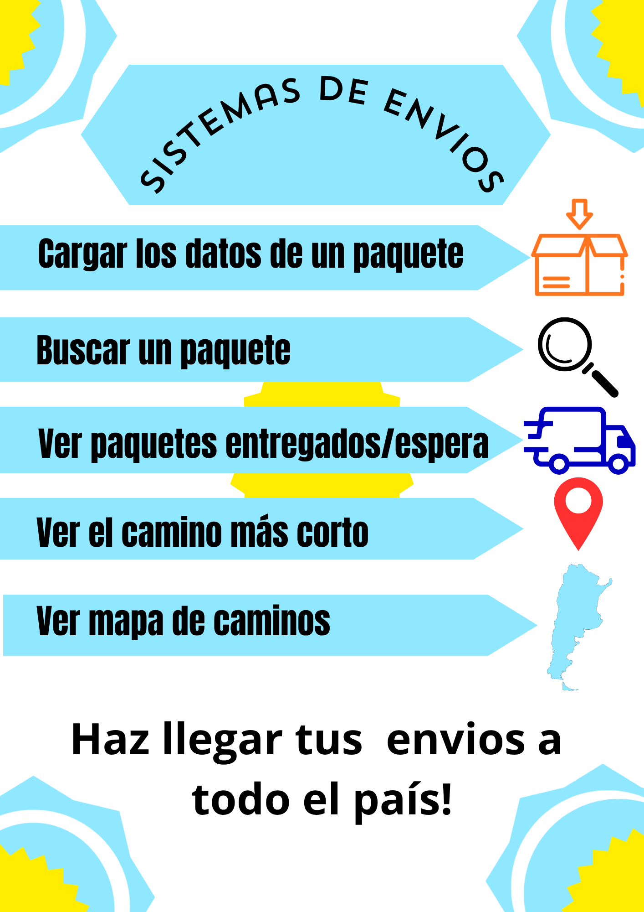

<div align="center">

# 📦 Dijkstra Delivery

### Sistema de paquetería en C con grafos, pilas, colas y TADs

Proyecto Integrador · **Algoritmo y Estructura de Datos 2**
Licenciatura en Sistemas de Información · **UNNE**




</div>

---

## 📖 Descripción

**Dijkstra Delivery** simula el funcionamiento de un sistema de paquetería que recorre las **24 provincias de Argentina**. El programa permite cargar paquetes, mantenerlos en una cola de pendientes, entregarlos en orden de llegada y calcular la **ruta más corta** entre la provincia de origen y la de destino usando el **algoritmo de Dijkstra**.

Está programado en **C** siguiendo el **paradigma estructurado** y totalmente **modularizado con TADs**.

## ✨ Características

- 🗺️ **Grafo de provincias**: matriz de pesos con las distancias en km entre provincias.
- 🛣️ **Ruta más corta** entre origen y destino con Dijkstra.
- 📥 **Cola dinámica** (FIFO) para los paquetes restantes.
- 📤 **Pila dinámica** para los paquetes entregados.
- 💾 **Persistencia en archivos**: los paquetes se guardan y cargan desde `paquetes.dat`.
- 📊 **Reportes** con corte de control, búsqueda y ordenamiento.
- 🖼️ **Mapa interactivo** de Argentina hecho con raylib.

## 🧱 Estructura del proyecto

| Archivo | Función |
|---|---|
| `main.c` | Programa principal y menús (**único archivo que se compila**) |
| `paquete.h` | TAD de paquete (`tPaquete`) |
| `cola.h` | Cola dinámica de paquetes restantes |
| `entregas.h` | Pila dinámica de paquetes entregados |
| `grafo.h` | TAD del grafo de provincias (matriz de pesos) |
| `dijkstra.h` | Ruta más corta entre provincias |
| `archivos.h` | Lectura y escritura de `paquetes.dat` y carga del mapa |
| `reportes.h` | Resúmenes, reportes y búsquedas |
| `mapa.h` | Interfaz gráfica del mapa interactivo (raylib) |
| `paquetes.dat` | Datos de los paquetes |
| `mapa.txt` | Distancias en km entre provincias |
| `mapaArgentina.png` | Imagen usada por el mapa interactivo |
| `raylib.h` / `libraylib.a` | Librería gráfica raylib |
| `docs/` | Informe y flyer del proyecto |

> ⚠️ Todos estos archivos deben estar en la **misma carpeta**. Los `.h` **no se compilan por separado**: `main.c` los incluye.

## ⚙️ Cómo compilar (Dev-C++)

El programa usa la librería gráfica **raylib** (incluida en esta carpeta: `raylib.h` y `libraylib.a`). Antes de compilar hay que configurar el linker:

1. Abrir **Dev-C++** y el archivo `main.c`.
2. Ir a **Herramientas > Opciones del compilador**.
3. Tildar *"Añadir los siguientes comandos cuando se llama al compilador"* y escribir:
   ```
   -lraylib -lopengl32 -lgdi32 -lwinmm
   ```
4. Ir a la pestaña **Directorios**:
   - En **Bibliotecas**, agregar la ruta de esta carpeta (donde está `libraylib.a`).
   - En **C Includes**, agregar la ruta de esta carpeta (donde está `raylib.h`).
5. Aceptar y compilar con **F11**.

Si no se configura el linker, aparecen errores de compilación.

## ▶️ Cómo ejecutar

Después de compilar, ejecutar el `main.exe` generado **desde esta misma carpeta** (Windows).

Al iniciar, el programa carga el mapa de provincias y los paquetes guardados en `paquetes.dat`, y muestra el menú principal.

> ❗ **Importante:** salir siempre con la opción **0**. Si se cierra la ventana sin salir por el menú, los cambios de esa sesión no se guardan.

## 🧭 Uso del menú

Se elige cada opción escribiendo su número y presionando **Enter**. Si el número está fuera de rango, el programa lo vuelve a pedir.

### Menú principal

| Opción | Acción |
|:---:|---|
| **1** | Cargar nuevo paquete (el ID se asigna solo) |
| **2** | Ver paquetes restantes, en orden de llegada |
| **3** | Ver solo los restantes con prioridad |
| **4** | Entregar el siguiente paquete y mostrar la ruta más corta entre origen y destino |
| **5** | Ver paquetes entregados, del más reciente al más antiguo |
| **6** | Ver la última entrega |
| **7** | Mapa de provincias (submenú) |
| **8** | Reportes (submenú) |
| **9** | Guardar datos en `paquetes.dat` sin salir |
| **0** | Guardar los datos y salir |

### 7 · Mapa de provincias

1. Ver conexiones entre provincias
2. Ver distancias en km
3. Ver mapa interactivo
0. Volver

En el **mapa interactivo**: *click izquierdo* para seleccionar una provincia y *click derecho* para reiniciar.

### 8 · Reportes

1. Resumen general
2. Reporte de entregados
3. Paquetes por provincia de destino
4. Buscar paquete por ID
0. Volver

## 📋 Datos útiles

**Estados de un paquete**

| Código | Estado |
|:---:|---|
| 1 | En sucursal |
| 2 | En camino |
| 3 | Entregado |

**Prioridad:** `1` = prioritario, `0` = normal. Solo sirve para filtrar la vista de pendientes (opción 3); los paquetes siempre se entregan en orden de llegada.

**Provincias** (se ingresan con su número, de 1 a 24)

| N° | Provincia | N° | Provincia | N° | Provincia |
|:---:|---|:---:|---|:---:|---|
| 1 | Buenos Aires | 9 | Formosa | 17 | Salta |
| 2 | CABA | 10 | Jujuy | 18 | San Juan |
| 3 | Catamarca | 11 | La Pampa | 19 | San Luis |
| 4 | Chaco | 12 | La Rioja | 20 | Santa Cruz |
| 5 | Chubut | 13 | Mendoza | 21 | Santa Fe |
| 6 | Córdoba | 14 | Misiones | 22 | Santiago del Estero |
| 7 | Corrientes | 15 | Neuquén | 23 | Tierra del Fuego |
| 8 | Entre Ríos | 16 | Río Negro | 24 | Tucumán |

## 🚀 Ejemplo rápido

El grupo incluye un archivo de pruebas (`paquetes.dat`) con aproximadamente **300 paquetes**. Si no querés usarlo, podés eliminarlo y el programa generará uno nuevo.

1. Ejecutar el programa.
2. **Opción 1:** cargar un par de paquetes.
3. **Opción 2:** ver la lista de pendientes.
4. **Opción 4:** entregar un paquete y ver la ruta.
5. **Opción 5:** ver las entregas realizadas.
6. **Opción 0:** salir (se guardan los datos).
7. Volver a ejecutar: los paquetes siguen ahí.

## 📄 Documentación

- 📝 [Informe del proyecto](docs/Informe%20Proyecto%20Integrador.docx)
- 🎨 [Flyer](docs/Flyer_grupo_P.png)

## 👥 Integrantes

- Moreno Gonzalez, Matias Benjamin
- Palacio, Enrique Alfredo
- Penayo, Enrique Ariel
- Woznirck, Lautaro Ezequiel

---

<div align="center">

Proyecto Integrador · Algoritmo y Estructura de Datos 2 · UNNE · 2026

</div>
